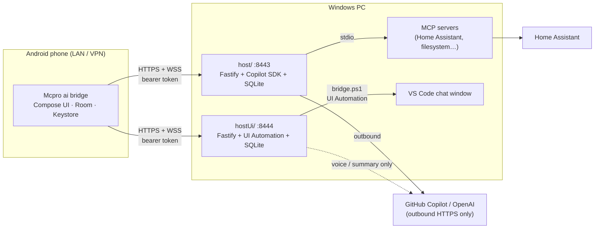

# AIAgentBridge

Talk to an AI coding/home-automation agent running on your Windows PC from a native Android app, by text or push-to-talk voice, over **your own private LAN or VPN**. No cloud relay, no public ports, no wake word.

AIAgentBridge has three parts:

| Component | Folder | What it does |
| --- | --- | --- |
| **Copilot API host** | [`host/`](host/) | Standalone HTTPS + WebSocket server built on the official [`@github/copilot-sdk`](https://www.npmjs.com/package/@github/copilot-sdk). Runs its own persistent multi-turn agent sessions with explicitly configured MCP tools (for example Home Assistant), approval gating and clarification questions. Default port **8443**. |
| **Live VS Code relay** | [`hostUi/`](hostUi/) | Experimental HTTPS + WebSocket server that drives the chat already open in VS Code through Windows UI Automation. Text from the phone is typed into that chat and the rendered reply is sent back. Default port **8444**. |
| **Android app** | [`android/`](android/) | Native Kotlin/Jetpack Compose client ("Mcpro ai bridge"). Streams replies, keeps per-server pairings and histories, push-to-talk voice, optional spoken summaries, biometric approvals. |

> **Status.** Host and relay pass their typecheck, build and automated test suites, and the Android project builds and passes its unit tests and lint. Some features require your own credentials (GitHub Copilot token, OpenAI key, Home Assistant token) and a trusted TLS certificate before they work end to end. See [Current status and limitations](#current-status-and-limitations).

---

## Table of contents

- [Features](#features)
- [Architecture](#architecture)
- [Security model](#security-model)
- [Repository layout](#repository-layout)
- [Installation](#installation)
  - [1. Prerequisites](#1-prerequisites)
  - [2. Get the code](#2-get-the-code)
  - [3. Create a TLS certificate](#3-create-a-tls-certificate)
  - [4. Set up the Copilot API host](#4-set-up-the-copilot-api-host-host)
  - [5. Set up the Live VS Code relay (optional)](#5-set-up-the-live-vs-code-relay-optional-hostui)
  - [6. Open the Windows Firewall](#6-open-the-windows-firewall)
  - [7. Build and install the Android app](#7-build-and-install-the-android-app)
  - [8. Pair the phone](#8-pair-the-phone)
- [Configuration reference](#configuration-reference)
- [Code documentation](#code-documentation)
  - [Copilot API host](#copilot-api-host-host)
  - [Live VS Code relay](#live-vs-code-relay-hostui)
  - [Android app](#android-app-android)
- [HTTP and WebSocket protocol](#http-and-websocket-protocol)
- [Development](#development)
- [Troubleshooting](#troubleshooting)
- [Current status and limitations](#current-status-and-limitations)
- [License](#license)

---

## Features

- **Two server modes, one app.** Switch between the Copilot SDK host and the live VS Code relay from the app's Settings. Each mode has its own address, pairing token and local history.
- **Streaming chat.** Replies stream over an authenticated WebSocket. Conversations persist in SQLite on the host and in Room on the phone.
- **Reconnect replay.** Every event has a monotonic sequence number. After a reconnect the app replays everything it missed.
- **Push-to-talk voice.** Hold to record, release to upload. The host transcribes with OpenAI speech-to-text. Nothing is recorded in the background and there is no wake word.
- **Read replies aloud (optional).** The full reply is always shown. When enabled, the host makes a short AI summary (60 words or fewer) and the phone speaks it with Android text-to-speech.
- **Clarification questions and approvals.** The agent can ask a question or request permission. You answer on the phone, optionally confirming approvals with a strong biometric.
- **Policy outside the model.** Unknown tools are denied by default. Read-only and write operations are classified by host code, not by the model.
- **Secure pairing.** One-use pairing codes expire after five minutes. Device tokens are random, stored only as SHA-256 hashes on the host, kept in Android Keystore-backed storage on the phone, and can be revoked.
- **Home Assistant tools.** An optional built-in MCP server exposes read-only Home Assistant API tools plus a service-call tool.

## Architecture



**Request flow (Copilot API host):**

1. The phone sends `message.create` over the WebSocket.
2. `CopilotService` sends it to a persistent Copilot SDK session for that conversation.
3. SDK events become bridge events (`message.delta`, `tool.status`, `approval.requested`, …). Each one is written to SQLite with a sequence number and then broadcast to connected devices.
4. Permission requests go through `mcp-policy.ts`. Allowlisted read-only Home Assistant tools are approved automatically. Everything else needs an approval from the phone, and unknown tools are denied.
5. The phone renders the events, saves them in Room and, if read-aloud is on, asks `/api/voice/summary` for a short version to speak.

**Request flow (Live VS Code relay):**

1. `RelayService` takes a snapshot of the visible chat transcript through `bridge.ps1`.
2. It types the message into the Chat Input, checks the draft and presses Send.
3. It polls until a new assistant reply is complete, then emits `message.completed`.
4. Approvals and questions shown in VS Code must be handled on the PC. The relay never clicks them.

## Security model

- **Private network only.** The servers refuse wildcard and public bind addresses. Bind to `127.0.0.1` or a specific private LAN/VPN IP. Never forward these ports through your router.
- **HTTPS only, real certificate checks.** Use a certificate whose SAN matches the address the phone uses, and install its CA on the phone. The app never turns off TLS verification.
- **Pairing.** `npm run pair` runs only on the PC and prints a 16-character hex, single-use code that expires in five minutes. `/api/pair` allows 8 attempts per IP every 5 minutes.
- **Tokens.** Tokens are 256-bit random values. The host stores only their SHA-256 hashes. The phone keeps tokens in Keystore-backed encrypted storage. Revoking a device closes its live sockets.
- **Isolated credentials.** The Copilot SDK runs with `COPILOT_GITHUB_TOKEN` and a small allowlist of environment variables. It does not reuse your VS Code or Copilot CLI login. MCP servers receive only the environment variables you list for them.
- **Default-deny tools.** No built-in shell or filesystem tools are enabled. MCP tools must be named in an allowlist. Tool calls that aren't recognised are denied.
- **Limits.** Request bodies are capped at 1 MB and voice uploads at 20 MB. WebSocket frames are capped at 128 KiB, and the relay also limits each connection to 60 packets per minute.
- **Logs.** The host's detailed activity log includes conversation text and redacts common token formats. Treat terminal output as sensitive, or set `ACTIVITY_LOGGING=false`.

Never commit `.env`, `mcp-servers.json`, `certs/` or `.data/`. The included [`.gitignore`](.gitignore) excludes all of them.

## Repository layout

```text
AIAgentBridge/
├── host/                         Copilot SDK host (Node.js / TypeScript)
│   ├── src/
│   │   ├── main.ts               Entry point: load config, open store, start HTTPS server
│   │   ├── config.ts             .env parsing, bind-address validation, MCP config loader
│   │   ├── server.ts             Fastify routes, WebSocket protocol, voice endpoints
│   │   ├── copilot.ts            CopilotService: SDK sessions, events, approvals, questions
│   │   ├── mcp-policy.ts         Tool permission policy (auto-approve / prompt / deny)
│   │   ├── store.ts              BridgeStore: SQLite schema and data access
│   │   ├── pair.ts               CLI: create a one-use pairing code
│   │   ├── ha-mcp.ts             Stdio MCP server exposing Home Assistant tools
│   │   ├── ha-api.ts             Typed Home Assistant REST client
│   │   └── activity-log.ts       Structured terminal logging with secret redaction
│   ├── tests/                    Vitest suites
│   ├── .env.example              Configuration template (no secrets)
│   └── mcp-servers.example.json  MCP server template
├── hostUi/                       Live VS Code relay (Node.js / TypeScript + PowerShell)
│   ├── src/
│   │   ├── main.ts               Entry point
│   │   ├── config.ts             HOST_UI_* configuration
│   │   ├── server.ts             Fastify routes and WebSocket (same protocol as host)
│   │   ├── relay.ts              RelayService: submit, capture, emit events
│   │   ├── ui-adapter.ts         WindowsUiAdapter: calls bridge.ps1 and parses snapshots
│   │   ├── ui-cli.ts             CLI: ui:inspect / ui:bind / ui:probe
│   │   ├── store.ts              SQLite store (separate database)
│   │   └── pair.ts               CLI: pairing code
│   ├── automation/bridge.ps1     Windows UI Automation worker for VS Code
│   ├── tests/
│   └── .env.example
└── android/                      Android client (Kotlin, Jetpack Compose)
    └── app/src/main/java/com/agentbridge/android/
        ├── MainActivity.kt       Compose UI: chat, settings, pairing, PTT, approvals
        ├── data/
        │   ├── BridgeClient.kt       OkHttp REST + WebSocket client
        │   ├── BridgeProtocol.kt     Packet encoding/decoding
        │   ├── BridgeRepository.kt   Sync, replay, send, voice, summary
        │   ├── BridgeDatabase.kt     Room entities and DAO
        │   └── ServerMode.kt         LIVE / COPILOT profiles
        ├── security/
        │   └── DeviceTokenStore.kt   Keystore-backed per-profile token storage
        └── ui/
            ├── BridgeViewModel.kt     App state, profiles, migration, read-aloud
            ├── ConversationTimeline.kt Turns event rows into chat items
            ├── PhoneSpeech.kt         Android text-to-speech with audio focus
            └── ReadAloudGate.kt       Decides which replies get spoken
```

---

## Installation

### 1. Prerequisites

**Windows PC**

| Requirement | Notes |
| --- | --- |
| Windows 10/11 | The relay must run in an unlocked, interactive desktop session. |
| [Node.js](https://nodejs.org/) **24 or later** | Includes npm. Check with `node -v`. |
| [Git](https://git-scm.com/) | To clone this repo. |
| [mkcert](https://github.com/FiloSottile/mkcert) (recommended) | Makes a private CA and server certificate. Install with `winget install FiloSottile.mkcert`. |
| GitHub Copilot subscription and token | For `host/`. Use a dedicated token in `COPILOT_GITHUB_TOKEN`. |
| OpenAI API key (optional) | Enables voice transcription, host speech and spoken summaries. |
| Home Assistant long-lived token (optional) | For the Home Assistant MCP tools. |
| VS Code (relay only) | With `"editor.accessibilitySupport": "on"`. |

**Building the Android app**

- **Android Studio** (Ladybug or newer). Simplest option.
- Or the command-line tools: **JDK 17**, **Android SDK Platform 35** with build-tools, and **Gradle 8.9**. The repo doesn't include a Gradle wrapper.

**Phone**

- Android 8.0 (API 26) or newer.
- On the same LAN as the PC, or connected over your VPN (for example WireGuard or Tailscale).

### 2. Get the code

```powershell
git clone https://github.com/mcpro777/AIAgentBridge.git
cd AIAgentBridge
```

### 3. Create a TLS certificate

The phone must trust the certificate, and the certificate must cover the exact address the phone connects to. With mkcert:

```powershell
mkcert -install                                   # creates and trusts a local CA on this PC
mkdir host\certs
mkcert -cert-file host\certs\host.crt -key-file host\certs\host.key 192.168.1.50 my-pc.lan localhost 127.0.0.1
```

Replace `192.168.1.50` and `my-pc.lan` with your PC's private IP and hostname. Give it a DHCP reservation so the IP doesn't change.

**Install the CA on the phone** (do this once):

1. Run `mkcert -CAROOT` and copy **`rootCA.pem`** from that folder to the phone, for example over USB.
2. On the phone, go to **Settings → Security & privacy → More security settings → Encryption & credentials → Install a certificate → CA certificate**. Menu names vary by manufacturer.
3. Accept the warning. Only install CAs you created yourself.

> Never copy `rootCA-key.pem` or `host.key` to the phone, and never commit them.

The relay can reuse the same certificate (see `hostUi/.env.example`), or you can create a separate one in `hostUi\certs`.

### 4. Set up the Copilot API host (`host/`)

```powershell
cd host
npm ci
Copy-Item .env.example .env
notepad .env
```

Edit `.env` with at least these values:

```dotenv
HOST_BIND=192.168.1.50              # your PC's private IP (not 0.0.0.0)
PORT=8443
TLS_CERT_PATH=./certs/host.crt
TLS_KEY_PATH=./certs/host.key
COPILOT_GITHUB_TOKEN=<dedicated token>
OPENAI_API_KEY=<optional, enables voice + summaries>
```

**Optional: Home Assistant tools**

1. In Home Assistant, open your profile, then **Security → Long-lived access tokens**, and create a token for AIAgentBridge.
2. Add it to `host/.env`:

   ```dotenv
   HA_BASE_URL=http://homeassistant.local:8123
   HA_TOKEN=<token>
   ```

3. Copy `mcp-servers.example.json` to `mcp-servers.json`.
   - Set `workingDirectory` to the absolute path of your `host` folder.
   - Keep only the tools you want.
   - Remove the `ha_files` server unless you want filesystem access. Its writes are always approval-gated.

> `ha_call_service` can call **any** Home Assistant service available to that token, and it runs without a confirmation prompt. Remove it from the `tools` list if you want read-only access.

Build, test and run:

```powershell
npm run typecheck
npm test
npm run build
npm start
```

### 5. Set up the Live VS Code relay (optional, `hostUi/`)

```powershell
cd ..\hostUi
npm ci
Copy-Item .env.example .env     # set HOST_UI_BIND and the TLS paths; optionally HOST_UI_OPENAI_API_KEY
npm run build
npm run ui:inspect              # checks that VS Code and its chat are visible to UI Automation
npm start
```

VS Code requirements:

- Set `"editor.accessibilitySupport": "on"` in VS Code settings.
- Keep the chat visible.
- Run the relay as the **same Windows user**, from a **non-elevated** terminal. Don't run it as a Windows service.

The relay picks the first VS Code window and its focused (or first visible) chat. To pin a specific window, run `npm run ui:bind -- --pid <pid>`. Run `npm run ui:bind` without `--pid` to go back to automatic selection.

See [hostUi/README.md](hostUi/README.md) for how capture works and its safety checks.

### 6. Open the Windows Firewall

Allow each port only on the **Private** profile, and only from your LAN/VPN subnet:

```powershell
# Run in an elevated PowerShell; adjust the subnet to match your network / VPN
New-NetFirewallRule -DisplayName "AIAgentBridge host"  -Direction Inbound -Protocol TCP -LocalPort 8443 -Profile Private -RemoteAddress 192.168.1.0/24 -Action Allow
New-NetFirewallRule -DisplayName "AIAgentBridge relay" -Direction Inbound -Protocol TCP -LocalPort 8444 -Profile Private -RemoteAddress 192.168.1.0/24 -Action Allow
```

Make sure Windows treats your network as **Private**: Settings → Network & Internet → (your network) → Network profile type.

### 7. Build and install the Android app

**Android Studio:** open the `android/` folder, let Gradle sync, then choose **Run** or **Build → Build APK(s)**.

**Command line** (JDK 17, Android SDK 35 and Gradle 8.9 on PATH):

```powershell
cd android
# create local.properties pointing to your SDK, e.g.  sdk.dir=C\:\\Android\\Sdk
gradle :app:testDebugUnitTest :app:lintDebug :app:assembleDebug
```

The APK is written to `android/app/build/outputs/apk/debug/app-debug.apk`.

**Sideload it:**

```powershell
adb install -r android\app\build\outputs\apk\debug\app-debug.apk
```

Or copy the APK to the phone and open it. You'll need to allow "Install unknown apps" for your file manager.

> Debug builds are signed with your local debug key. If you later install a build signed with a different key, uninstall the old app first (this deletes its local data).

### 8. Pair the phone

1. On the PC, in the server's folder, run:

   ```powershell
   npm run pair        # prints a single-use code valid for 5 minutes
   ```

2. On the phone, open **Mcpro ai bridge**, then the **gear icon → Settings**.
3. Choose the mode (**Copilot API** or **Live VS Code**) and enter the URL, for example `https://192.168.1.50:8443`.
4. Enter the pairing code and tap **Pair**.

Repeat for the other mode if you use both. Each mode keeps its own pairing and history.

In Settings you can also:

- Manage and revoke paired devices.
- Turn on **Read replies aloud**. This needs an OpenAI key on the host and an Android TTS voice installed on the phone.

---

## Configuration reference

### `host/.env`

| Variable | Default | Purpose |
| --- | --- | --- |
| `HOST_BIND` | `127.0.0.1` | Interface to listen on. Must be loopback or a specific private IP. |
| `PORT` | `8443` | HTTPS port. |
| `TLS_CERT_PATH` / `TLS_KEY_PATH` | `./certs/host.crt` / `./certs/host.key` | Server certificate and private key. |
| `DATA_DIR` | `./.data` | SQLite database and Copilot session state. |
| `MCP_CONFIG_PATH` | `./mcp-servers.json` | MCP server definitions. If the file is missing, no tools are enabled. |
| `FILESYSTEM_ROOTS` | *(empty)* | Optional absolute Windows paths for the SDK working directory. This does **not** enable file tools. |
| `ACTIVITY_LOGGING` | `true` | Detailed, redacted content logging to the terminal. |
| `COPILOT_GITHUB_TOKEN` | — | **Required** for Copilot replies. |
| `OPENAI_API_KEY` | — | Enables `/api/voice/*`. |
| `OPENAI_STT_MODEL` | `gpt-4o-mini-transcribe` | Speech-to-text model. |
| `OPENAI_TTS_MODEL` | `tts-1` | Host speech synthesis model. |
| `OPENAI_SUMMARY_MODEL` | `gpt-4o-mini` | Model for spoken summaries. |
| `HA_BASE_URL` / `HA_TOKEN` | — | Passed only to the Home Assistant MCP server, through `${…}` references. |

### `host/mcp-servers.json`

```jsonc
{
  "servers": [
    {
      "name": "homeassistant",            // tool ids become mcp:<name>-<tool>
      "type": "stdio",
      "command": "C:\\Program Files\\nodejs\\node.exe",
      "args": ["dist/ha-mcp.js"],
      "workingDirectory": "C:\\path\\to\\AIAgentBridge\\host",
      "tools": ["ha_get_states", "ha_get_state"],   // explicit allowlist
      "env": { "HA_BASE_URL": "${HA_BASE_URL}", "HA_TOKEN": "${HA_TOKEN}" }
    }
  ]
}
```

Only the `env` entries you list are passed to the server. `${NAME}` is replaced with that variable from the host's environment.

### `hostUi/.env`

| Variable | Default | Purpose |
| --- | --- | --- |
| `HOST_UI_BIND` | `127.0.0.1` | Loopback or a specific private IP. |
| `HOST_UI_PORT` | `8444` | HTTPS port. |
| `HOST_UI_TLS_CERT_PATH` / `HOST_UI_TLS_KEY_PATH` | `.\certs\host.crt` / `.\certs\host.key` | Certificate and key. |
| `HOST_UI_DATA_DIR` | `.\.data` | Separate SQLite database (`agentbridge-ui.sqlite`). |
| `UI_TARGET_FILE` | `.\.data\ui-target.json` | Optional pinned-window binding. |
| `HOST_UI_OPENAI_API_KEY` | — | Enables voice and summaries. Not inherited from `host/`. |
| `HOST_UI_OPENAI_STT_MODEL` / `_TTS_MODEL` / `_SUMMARY_MODEL` | same as host | Model overrides. |

---

## Code documentation

### Copilot API host (`host/`)

**Stack:** Node.js 24+, TypeScript (ESM), Fastify 5, `@fastify/websocket`, `@fastify/multipart`, `better-sqlite3`, `@github/copilot-sdk`, `@modelcontextprotocol/sdk`, Vitest.

#### `main.ts`

Startup:

1. Calls `loadConfig()` and `loadMcpConfig()`.
2. Reads the TLS key pair.
3. Opens `BridgeStore`.
4. Constructs `CopilotService`.
5. Starts the Fastify server from `createServer()` on `HOST_BIND:PORT`.

#### `config.ts`

- `loadConfig(): RuntimeConfig` reads `.env` and process variables and applies defaults.
- `validateBindAddress(bind)` accepts only loopback and private or CGNAT IPv4/IPv6 literals. It rejects `0.0.0.0`, `::` and public addresses.
- `loadMcpConfig(path)` parses and validates `mcp-servers.json` into SDK `MCPServerConfig` objects plus the set of allowlisted tool ids. It expands `${VAR}` placeholders only inside each server's `env`.

#### `store.ts`: `BridgeStore`

SQLite in WAL mode. Tables cover devices, pairing codes, conversations, events (with a monotonic autoincrement `sequence`), approvals and questions.

- **Pairing:**
  - `createPairingCode(ttlMs = 5 min)` stores only the code's hash.
  - Redeeming a code is atomic and one-time; it creates a device and returns its token once.
  - Device tokens are checked by SHA-256 hash.
- **Conversations:** create, list, delete, and look up the Copilot session id.
- **Events:**
  - Each event is appended with the next `seq`.
  - `listEvents(conversationId, after, limit ≤ 500)` returns `{ events, nextAfter, hasMore }` for replay.
- **Approvals and questions:** stored with an expiry and resolved exactly once.

#### `copilot.ts`: `CopilotService`

Manages one persistent Copilot SDK session per conversation.

- Creates or resumes sessions with:
  - The explicit `COPILOT_GITHUB_TOKEN`.
  - A minimal environment.
  - The configured MCP servers.
  - The data directory as working directory.
- Translates SDK session events into bridge events:

  | SDK event | Bridge event |
  | --- | --- |
  | assistant deltas and messages | `message.delta`, `message.completed` (whitespace-only messages are skipped) |
  | `tool.execution_start` / `tool.execution_complete` | `tool.status` |
  | `session.error` | `error` |

- Handles SDK permission callbacks:
  1. Classifies the request with `mcp-policy.ts`.
  2. Auto-approves, or emits `approval.requested` and waits for the phone's `approval.respond`.
  3. Unanswered approvals expire and are denied.
- Handles user-input requests by emitting `question.asked` and waiting for `question.answer`, with a timeout that emits `question.expired`.
- Allows one active turn per conversation; a second send throws `ConversationBusyError`.
- Redacts tokens from text it logs or surfaces.

#### `mcp-policy.ts`

- `resolveConfiguredMcpToolId(request, configuredTools)` maps an SDK MCP permission request to a configured id of the form `mcp:<server>-<tool>`, but only if that tool is in the server's allowlist.
- `isAutoApprovedMcpOperation(...)` returns true only for:
  - Read-only requests for the listed Home Assistant `ha_get_*` and `ha_check_api` tools on a server named `homeassistant`.
  - Write requests for `mcp:homeassistant-ha_call_service`.

  Filesystem tools and everything else need an approval. Anything not recognised is denied.

#### `server.ts`

- `createServer(config, store, copilot, tls)` builds the HTTPS Fastify app:
  - Request bodies up to 1 MB; multipart uploads up to 20 MB with a single file.
  - A bearer-token hook protects every `/api/*` route except `/api/health` and `/api/pair`.
  - A per-IP rate limit protects pairing.
- `registerWebSocketRoute(...)` implements the [WebSocket protocol](#websocket-apiws):
  - The first frame must authenticate.
  - It routes `message.create`, `question.answer` and `approval.respond`.
  - It broadcasts persisted events to all of that device's sockets.
- Voice routes call the OpenAI API with `fetch`:
  - Transcription.
  - Speech.
  - Summary: a stateless chat completion, at most 120 tokens and ≤ 60 words. The source text is treated as untrusted data.

#### `ha-mcp.ts` and `ha-api.ts`

A stand-alone stdio MCP server, started by the SDK as a child process, built on `HomeAssistantApi`, a typed REST client using `HA_BASE_URL`/`HA_TOKEN`. Tools:

| Category | Tools |
| --- | --- |
| Status and setup | `ha_check_api`, `ha_get_config`, `ha_get_components` |
| Entities | `ha_get_states`, `ha_get_state` |
| Services | `ha_get_services`, `ha_call_service` |
| Activity and logs | `ha_get_events`, `ha_get_history`, `ha_get_logbook`, `ha_get_error_log` |
| Calendars | `ha_get_calendars`, `ha_get_calendar_events` |

#### `activity-log.ts`

- `logActivity(event, details)` prints structured JSON lines.
- `redactForLog()` and `redactSensitiveText()` mask credential-like keys, GitHub token formats, bearer headers and PEM blocks.

#### `pair.ts`

A local-only CLI that opens the store and prints a fresh pairing code. The API itself can't create pairing codes.

### Live VS Code relay (`hostUi/`)

#### `server.ts`

The same REST, WebSocket and voice protocol as `host/`, so the Android client works unchanged.

- Questions and approvals are rejected, because they must be handled in VS Code.
- WebSocket limits: 128 KiB per frame and 60 packets per minute per connection.
- An unauthenticated socket is closed after 5 seconds.

#### `relay.ts`: `RelayService`

Handles one request at a time, across all conversations:

1. Snapshot the transcript, so later messages can be identified by their stable ids.
2. Submit the message, then check that a user message with the exact text appeared.
3. Poll until a new assistant message reports `completed: true`, or stays idle and stable on adapters without completion markers.
4. Emit `message.completed`.

Timeouts, ambiguous submissions or a changed chat:

- Persist an `error` event.
- **Lock further sends** until the relay is restarted, to avoid duplicate work.

#### `ui-adapter.ts`: `WindowsUiAdapter`

Runs `automation/bridge.ps1` with Windows PowerShell and validates its JSON output with `parseSnapshot()`. The output contains the window, the transcript identity, the messages (with role, id, text and completion state) and whether the chat is busy.

#### `automation/bridge.ps1`

The UI Automation worker. It:

- Finds the first VS Code window (or the pinned one).
- Chooses the visible chat with keyboard focus, or else the first visible chat.
- Reads Markdown, plain-text and table content, excluding tool output.
- Types text with `SendInput` (Unicode), checks the draft, then invokes the uniquely identified **Send** button.

It does not use the clipboard, screen coordinates or a debugging port.

#### `ui-cli.ts`

| Command | What it does |
| --- | --- |
| `ui:inspect` | Shows the selected window and chat, without changing anything. |
| `ui:bind [-- --pid N]` | Saves automatic or pinned window selection. |
| `ui:probe` | Types and then clears a test draft without sending it. |

### Android app (`android/`)

**Stack:**

- Kotlin 2.0, Jetpack Compose (Material 3), AGP 8.7.
- `compileSdk`/`targetSdk` 35, `minSdk` 26.
- OkHttp (REST and WebSocket), Room (via KSP), AndroidX Biometric.
- Tokens are encrypted with an AES-GCM key held in the Android Keystore.

| File | Responsibility |
| --- | --- |
| `MainActivity.kt` | Compose screens: full-screen chat timeline, composer, hold-to-talk mic, conversation picker, Settings (mode, URL, pairing, devices, read-aloud), question and approval cards. Strong-biometric confirmation (`BiometricPrompt`, `BIOMETRIC_STRONG`) for approvals. |
| `ui/BridgeViewModel.kt` | Single source of UI state (`BridgeState`). Owns the active profile and repository, migrates the pre-1.1 single profile, tracks the selected conversation per mode and the foreground state, and starts read-aloud. |
| `data/ServerMode.kt` | `LIVE` and `COPILOT` profiles. `legacyMode(url)` maps an old URL to a profile: port 8443 means Copilot, anything else means Live. |
| `data/BridgeClient.kt` | OkHttp REST calls (pair, conversations, events, devices, voice, summary) and the WebSocket. Uses platform TLS verification only. |
| `data/BridgeProtocol.kt` | Encodes and decodes JSON packets (`auth`, `message.create`, `question.answer`, `approval.respond`). |
| `data/BridgeRepository.kt` | Connects, authenticates, replays events (`after` = last stored sequence, paged until `hasMore` is false), saves events to Room, reconnects with backoff, uploads PTT audio and requests summaries. |
| `data/BridgeDatabase.kt` | Room entities `ConversationRow`, `EventRow` and `PairedDevice`, plus `BridgeDao`. One database per profile: `agentbridge.db` for the legacy profile, `agentbridge-<mode>.db` for the other. |
| `security/DeviceTokenStore.kt` | Per-profile device token and device id, encrypted with a per-profile AES-GCM key that never leaves the Android Keystore. The ciphertext is stored in private SharedPreferences. |
| `ui/ConversationTimeline.kt` | `buildConversationTimeline(events)` merges `message.user`, `message.delta`, `message.completed`, `tool.status`, question and approval events into display items. |
| `ui/ReadAloudGate.kt` | Speaks only live (not replayed), newly inserted `message.completed` events in the selected conversation while the app is in the foreground. |
| `ui/PhoneSpeech.kt` | Android `TextToSpeech` wrapper. Requests transient audio focus and reports when no voice is installed. |

Unit tests are in `app/src/test`: `BridgeProtocolTest`, `ServerModeTest`, `ConversationTimelineTest` and `ReadAloudGateTest`.

---

## HTTP and WebSocket protocol

Both servers implement this protocol. All routes are HTTPS. Except where marked *public*, requests need `Authorization: Bearer <token>`.

### REST

| Method and path | Body | Response |
| --- | --- | --- |
| `GET /api/health` *(public)* | — | `{ "status": "ok" }` |
| `POST /api/pair` *(public, rate-limited)* | `{ "code", "deviceName" }` | `{ "deviceId", "token" }`. The token is returned only this once. |
| `GET /api/conversations` | — | `{ "conversations": [{ id, title, updatedAt }] }` |
| `POST /api/conversations` | — | The new conversation. |
| `DELETE /api/conversations/:id` | — | Returns 409 while a reply is in progress. |
| `GET /api/conversations/:id/events?after=N` | — | `{ events, nextAfter, hasMore }`, up to 500 per page. |
| `GET /api/devices` | — | `{ "devices": [...] }` |
| `DELETE /api/devices/:id` | — | Revokes the token and closes its sockets. |
| `POST /api/voice/transcribe` | multipart field `audio` | `{ "text" }`. Returns 503 if no OpenAI key is set. |
| `POST /api/voice/speech` | `{ "text" }` | Audio bytes. |
| `POST /api/voice/summary` | `{ "text" }` (≤ 20,000 chars) | `{ "text" }` (≤ 60 words). Errors: 400 for bad input, 503 when not configured, 502 for a provider error, 504 on timeout. |

### WebSocket `/api/ws`

Client → server:

```jsonc
{ "type": "auth", "token": "<device token>" }                      // must be first; server replies { "type": "auth.ok" }
{ "type": "message.create", "conversationId": "…", "text": "…" }
{ "type": "question.answer", "questionId": "…", "answer": "…" }
{ "type": "approval.respond", "approvalId": "…", "decision": "approve" }   // or "deny"
```

IDs are UUIDs. Messages are limited to 20,000 characters and answers to 2,000. Invalid packets get `{ "type": "error", "message": "…" }`.

Server → client: persisted events. The payload fields are flattened alongside the metadata:

```jsonc
{ "sequence": 42, "conversationId": "…", "type": "message.delta", "createdAt": "…", "messageId": "…", "delta": "Hel" }
```

| Event type | Payload fields |
| --- | --- |
| `message.user` | `text` |
| `message.delta` | `messageId`, `delta` |
| `message.completed` | `messageId`, `text` |
| `tool.status` | `toolCallId`, `toolName`, `status` (`started` / `completed`), `summary` |
| `question.asked` | `questionId`, `prompt`, `choices?`, `allowFreeform`, `expiresAt` |
| `question.answered` / `question.expired` | `questionId`, `answer` / `reason` |
| `approval.requested` | `approvalId`, `operation`, `expiresAt` |
| `approval.completed` | `approvalId`, `decision`, `reason?` |
| `error` | `message` |
| `conversation.deleted` | `conversationId` (broadcast only, not persisted) |

To catch up after a reconnect, the client calls `GET /api/conversations/:id/events?after=<last sequence>` until `hasMore` is false.

---

## Development

```powershell
# host
cd host;   npm ci; npm run typecheck; npm test; npm run build
# relay
cd hostUi; npm ci; npm run typecheck; npm test; npm run build
# android
cd android; gradle :app:testDebugUnitTest :app:lintDebug :app:assembleDebug
```

`npm start` runs the compiled `dist/main.js`, so run `npm run build` after making changes. More detail in [host/README.md](host/README.md), [hostUi/README.md](hostUi/README.md) and [android/README.md](android/README.md).

---

## Troubleshooting

| Symptom | Likely cause and fix |
| --- | --- |
| Server refuses to start: *bind address* | `HOST_BIND` is `0.0.0.0` or a public IP. Use a specific private IP or `127.0.0.1`. |
| Phone shows a TLS / certificate error | The certificate SAN doesn't include the URL's IP or hostname, or the CA isn't installed on the phone. Recreate the certificate with the right SAN and install `rootCA.pem` as a **CA certificate**. |
| Phone can't connect at all | Windows Firewall rule missing, the network is set to *Public*, the server is bound to `127.0.0.1`, the PC's IP changed, or the VPN is down. Test from the PC with `curl.exe -k https://<ip>:8443/api/health`. |
| "Pairing failed" or 429 | The code expired (5 minutes), was already used, or there were too many attempts. Run `npm run pair` again and wait 5 minutes if rate-limited. |
| 401 after it was working | The device was revoked or the host database was reset. Unpair in Settings and pair again. |
| `Voice upload failed (503)` | No OpenAI key on that server (`OPENAI_API_KEY` or `HOST_UI_OPENAI_API_KEY`). Set it and restart. |
| Read-aloud is silent | The app is in the background, the summary endpoint returned an error, or no Android TTS voice is installed (Settings → System → Languages → Text-to-speech output). |
| Copilot replies never arrive | `COPILOT_GITHUB_TOKEN` is missing or invalid, or outbound HTTPS to GitHub is blocked. Check the host terminal. |
| Home Assistant tools are missing | `mcp-servers.json` is absent, the tool isn't in its `tools` allowlist, `workingDirectory` or the `node.exe` path is wrong, or `npm run build` hasn't been run (it creates `dist/ha-mcp.js`). |
| Relay: "chat not found" or "busy" | VS Code is minimized or locked, accessibility support is off, the chat isn't visible, or the relay is running elevated or as another user. Run `npm run ui:inspect`. |
| Relay refuses new sends | An earlier request timed out or was ambiguous. Finish or cancel it in VS Code, then restart the relay. |
| Windows services or mapped drives behave differently | Services run as a different account and don't see your mapped drives or user certificate store. Use absolute UNC paths, and run the relay interactively. |

---

## Current status and limitations

- **Automated checks pass:**
  - Host and relay: unit/integration tests, typecheck and build.
  - Android: unit tests, lint (warnings only) and debug APK build.
- **Not yet verified on a device:**
  - Copilot replies need your own Copilot token.
  - Voice and summary features need an OpenAI key.
  - The 1.1 Android UI changes (settings, per-mode profiles, read-aloud) haven't been checked on a phone yet.
- **The live VS Code relay is experimental.** It depends on VS Code's accessibility tree, which may change between VS Code releases. Replies arrive in full when complete rather than streaming, and are text only.
- **No release signing.** Builds are debug-signed for sideloading.

## License

[MIT](LICENSE) © 2026 mcpro777
